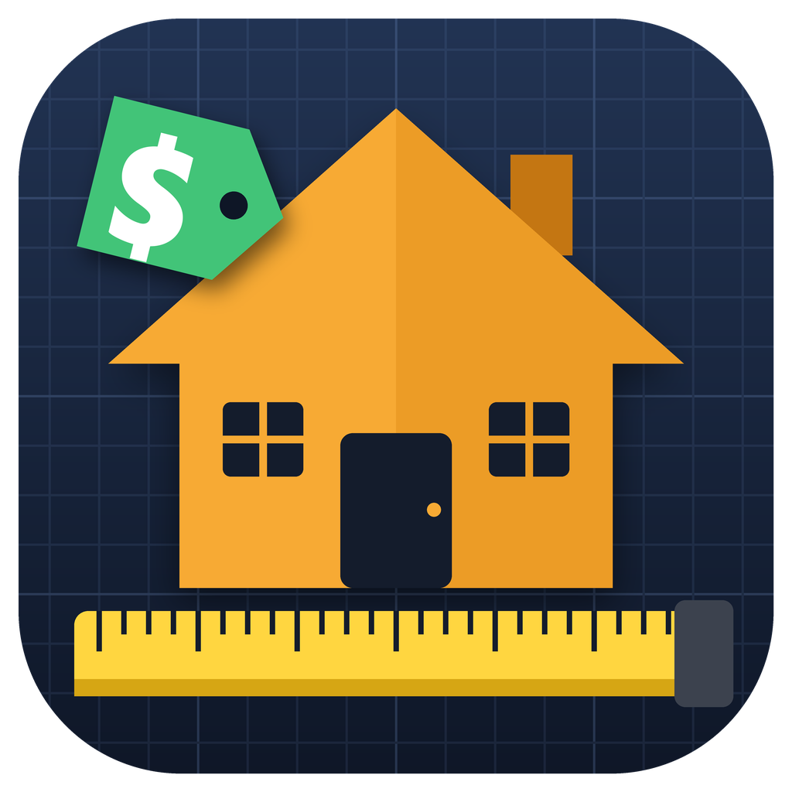

# Job Estimator

Take a couple of photos of a room, or the plans, say what the job is, and get a full
material takeoff, labor, and a priced estimate, with current lumber-yard prices.
Snap a picture and get a before/after preview of what the finished job will look like.

Made by R.E. Buotte Construction. Uses Claude by Anthropic: you need your own
Claude API key from [platform.claude.com](https://platform.claude.com/settings/keys)
(sign in, **Create key**, copy it, and paste it into the app's **⚙ Settings**).

| | Download |
|---|---|
| **Windows** 10 / 11 | [JobEstimator-Windows-Setup.exe](https://github.com/Rbuilder1/job-estimator-download/releases/latest/download/JobEstimator-Windows-Setup.exe) |
| **Mac** (Apple Silicon, M1 or newer) | [JobEstimator-mac.dmg](https://github.com/Rbuilder1/job-estimator-download/releases/latest/download/JobEstimator-mac.dmg) |
| **Android** | [JobEstimator-Android.apk](https://github.com/Rbuilder1/job-estimator-download/releases/latest/download/JobEstimator-Android.apk) |
| **iPhone / iPad** (advanced) | [JobEstimator-iPhone-unsigned.ipa](https://github.com/Rbuilder1/job-estimator-download/releases/latest/download/JobEstimator-iPhone-unsigned.ipa) |

None of these come from an app store, so each one asks you to confirm once:

## Windows

1. Run **JobEstimator-Windows-Setup.exe**. If Windows says "Windows protected your PC",
   click **More info**, then **Run anyway**.
2. Click through the installer. It doesn't need an administrator password. It adds Job
   Estimator to the Start menu (and the Desktop if you leave that box ticked).
3. To remove it later: **Settings → Apps → Installed apps → Job Estimator → Uninstall**.

## Mac

1. Open **JobEstimator-mac.dmg** and drag **Job Estimator** into **Applications**.
2. Open it from Applications. The first time, macOS says it can't verify the app. Click
   **Done**, then go to **System Settings → Privacy & Security**, scroll down, click
   **Open Anyway** next to Job Estimator, and confirm. You only do this once.

## Android

1. Open the link on the phone and download **JobEstimator-Android.apk**.
2. Open the downloaded file. If Android asks, allow your browser to **install unknown
   apps**, then tap **Install**.
3. 📸 **Take a picture & preview the job** opens the camera directly.

## iPhone / iPad

There's no App Store version yet, so the iPhone app has to be installed from a computer
with a free tool and your Apple ID:

1. Install **Sideloadly** on a Windows PC or Mac, and plug in the iPhone.
2. Drag **JobEstimator-iPhone-unsigned.ipa** into Sideloadly, sign in with your Apple ID,
   and click Start.
3. On the iPhone: **Settings → General → VPN & Device Management**, trust your Apple ID,
   and turn on **Developer Mode** if it asks.

With a free Apple ID, the app has to be reinstalled every 7 days.

## About the previews

Estimates work anywhere with an internet connection. The before/after previews are
painted by an image generator that runs on one Windows PC, the contractor's. On the
same Wi-Fi as that PC, enter its address and link code in ⚙ Settings to make previews.
